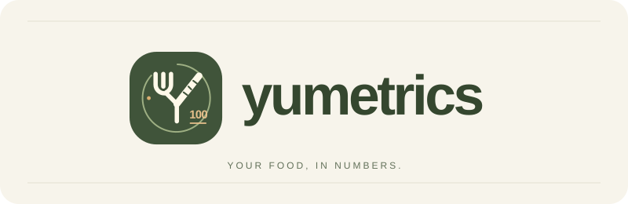

# Yumetrics



**[Élő alkalmazás](https://yumetrics.app)** · **[Magyar útmutató](https://yumetrics.app/utmutato)** · **[English guide](https://yumetrics.app/guide)**

Magyar és angol nyelvű étkezési napló Google-belépéssel, fotó alapján becsült tápértékekkel és javítható összetevőkkel. Az első AI-becslés a képen látható **teljes ehető étel és ital 100%-ából** indul ki; a naplóba mentendő mennyiséget a piszkozatban ellenőrizheted és javíthatod. A fotós elemzés nem közvetlen kalóriamérés: a felismerést, a mennyiségi becslést, a tápértékforrást és a számítást külön kezeljük.

## A számítás módszere és az AI szerepe

1. **Két nézet és vizuális leltár.** Két fotó kötelező: ételnél és kitöltött italnál felülről és ferdén oldalról ugyanarról az adagról; csomagolt terméknél a teljes termékről és ugyanannak a terméknek az olvasható tápértéktáblájáról. Az azonos képtartalmat feltöltés előtt elutasítjuk. A Gemini 4 Argon a képpár és a megadott információk alapján javaslatot tesz az ételre, az összetevőkre, az elkészítési állapotra és a g-ban vagy ml-ben megadott ehető mennyiségekre. A köretet, szószt és italt is számba kell vennie. Megkülönbözteti a látható vagy megadott elemeket a feltételezésektől, például a nem látható olajtól. Egyetlen részletes AI-kérés tartalmazza a képpár ellenőrzését, a leltárt, az adag- és tápértékbecslést, valamint a végső ellenőrzést.
2. **Ellenőrzés és forrásválasztás ugyanabban a válaszban.** Az AI ellenőrzi az adag azonosságát, az eltérő szöget, a képminőséget, a kihagyott/duplázott összetevőket és az elkészítést. A 44 USDA-rekord közül javasolhat megfelelő forrást; a szerver annak rögzített értékeit használja. Nyers referencia nem párosítható elkészített összetevőhöz.
3. **Tápértékek ugyanabban az AI-válaszban.** Minden összetevőhöz az egységének megfelelő 100 g-os vagy 100 ml-es tápérték is érkezik. Olvasható, az adott termékre és állapotra vonatkozó címkénél a szerver az eredeti címkeértékeket alakítja át; egyébként megfelelő USDA-forrást vagy számszerűen ellenőrzött AI-becslést használ. A részleges címkét és a becsült értékeket külön jelzi. Hiányos vagy ellentmondó válaszra nem indít kiegészítő AI-hívást. A megszakadt elemzéshez új, szolgáltatói költséggel járó kérés csak kifejezett kézi újrapróbáláskor indul; azonos feltöltés ismétlése nem küld új kérést.
4. **Mennyiség pontosítása.** Mérleg nélkül a grammok képi becslések. A megadott teljes ételtömegből levonjuk a külön lemért nem ehető részt, majd az összetevőket az így kapott ehető mennyiséghez arányosítjuk. A hús, köret és zsiradék egymáshoz viszonyított aránya ettől még becsült marad. Milliliteres tétel mellett a grammos össztömeget nem osztjuk szét sűrűség feltételezésével; az össztömeget ilyenkor hagyd üresen. Két fotó ugyanannak az adagnak két nézete; a mennyiséget nem duplázzuk.
5. **Szerveroldali számítás.** A g vagy ml mennyiséget az azonos egységre megadott 100-as tápértékkel szorozzuk, majd elosztjuk százzal; sűrűséget nem feltételezünk. Az összes összetevő eredményét összeadjuk. A végső adagérték tehát ellenőrizhető számítás eredménye, amelynek pontossága a bevitt mennyiségtől, az étel felismerésétől és a választott forrástól függ.
6. **Felhasználói ellenőrzés.** Az étel neve, mennyisége, elkészítése és tápértékforrása mentés előtt és után is javítható. Választható másik USDA-rekord vagy megadható termékcímke. Az eredeti AI-elemzést, a modell és a prompt verzióját, valamint a mentett javításokat külön őrizzük meg. Értékelhetetlen kép vagy hiányos AI-válasz esetén nem készítünk helyette kitalált eredményt.

```text
Összetevő tápértéke = mennyiség (g vagy ml) × azonos egységű 100-as tápérték ÷ 100
Teljes adag tápértéke = az összes ehető összetevő tápértékének összege
```

Szemléltető példa: 150 g összetevő 200 kcal/100 g értékkel 300 kcal-t ad az adaghoz. Ezek példaszámok, nem egy konkrét étel forrásadatai. Az energián kívül ugyanígy számoljuk a fehérjét, szénhidrátot és zsírt; további tápanyagot csak akkor közlünk, ha van hozzá adat. Az ismeretlen érték `null`, a felületen „—”, nem nulla.

### Mitől lehet megalapozottabb az eredmény?

| Megadott adat | Mit segít tisztázni? | Mi marad bizonytalan? |
| --- | --- | --- |
| Teljes ételtömeg és külön lemért csont/héj | Az egész adag ehető össztömegét | Az összetevők arányát továbbra is becsüljük |
| Külön lemért összetevők | Az adott összetevő grammjait | Az azonosságot, elkészítést és a tápértékforrást ellenőrizni kell |
| Második fotó, ismert tányérátmérő | A láthatóságot és a képi léptéket | Nem térfogatmérés és nem helyettesíti a mérleget |
| Elkészítés, hozzáadott olaj és szósz | A fotóból nem azonosítható hozzávalókat | A nem ismert receptet nem lehet biztosan rekonstruálni |
| Saját recept és lemért kész tömeg | A teljes recept tápértékének adagra osztását | A veszteségeket és az alapanyagok forrásadatait megfelelően kell megadni |

**Saját recept:** a teljes elkészült ételben maradt alapanyagok tápértékét összeadjuk, majd a képen látható adag tömegét a teljes kész étel tömegéhez viszonyítjuk. Ehhez nem kell újabb AI-hívás. A főzés előtti alapanyagtömegek összege nem helyettesíti a kész étel lemért tömegét; a visszamaradt vagy elöntött zsiradékot sem szabad elfogyasztottként számolni.

### A bizonytalanság értelmezése

A kalóriatartomány mennyiségi és összetételi forgatókönyveket mutat. Ismert ehető össztömegnél azonos össztömeg mellett változtatjuk az összetevőarányokat a becsült határaikon belül; ismeretlen össztömegnél az összetevők alsó és felső tömegbecsléseiből indulunk ki. Ez **nem statisztikai konfidenciaintervallum**, és nem garantálja, hogy a valódi érték a két határ közé esik. A téves felismerés, rejtett hozzávaló vagy rossz forráspárosítás további hibát okozhat.

Az AI azt jelzi, mennyire biztos a saját becslésében; ez nem méréssel igazolt pontosság. Nincs közzétett, lemért magyar ételfotókon igazolt Yumetrics-pontossági százalék. A szoftvertesztek a számítást és a működést ellenőrzik; a fotós becslés tényleges hibáját külön, ismert referenciaértékekkel kell megmérni. A napi energiakeret felhasználói beállítás, nem személyre szabott táplálkozási ajánlás.

Részletes módszertan: [PHOTO-ASSESSMENT.md](docs/PHOTO-ASSESSMENT.md). Források és kutatási döntések: [RESEARCH.md](docs/RESEARCH.md), [REFERENCE-CATALOG.md](docs/REFERENCE-CATALOG.md). A pontosságmérés eszköze: [BENCHMARK.md](docs/BENCHMARK.md).

Az első valódi, négy lemért Nutrition5k-étkezést vizsgáló AI-ellenőrzés eredményei és korlátai: [2026. november 9-i jelentés](docs/AI-VALIDATION-2026-11-09.md). A képpár-ellenőrzés és az ételnevek javultak; az összetevők azonossága és tömegaránya továbbra is tévedhet.

## Csomagolt termékek és italok

Az egyetlen AI-kérésben az étel-, ital- és édességfelismerés mellett címkeolvasás is történik. Teljes termékfotó + ugyanazon csomag másik oldalán olvasható tápértéktábla is elfogadott képpár. A címke eredeti számai, alapja, termékneve, márkája, nettó mennyisége, olvasható összetevő- és allergénszövege megmarad; a vonalkód ellenőrzőszámát ellenőrizzük, de termékadatbázisból nem találgatunk márkás termékértéket. A szerver átszámítja az adagértékeket 100 g/100 ml alapra, a kJ-t kcal-ra, a sót nátriumra, az amerikai összes szénhidrátot rost nélküli értékre. Az energia- és sóadatok összhangját azonos, 100 g/100 ml-es alapon ellenőrzi. A címkés csomagmennyiséget nem kerekíti a fotós becslés ezredes felbontására. Az olvashatatlan értéket hiányzó adatként (`null`) tároljuk, nem nullaként (`0`). A gramm és ml nem válik egymásba sűrűség nélkül. A címke megváltoztatott tápértéke saját adat lesz, a címkés forrásként megjelölt eredeti pillanatkép nem írható át kliensoldalról.

Bontatlan csomagnál a látható teljes csomagok nettó mennyisége az alapértelmezett adag; felbontott csomagnál a teljes kiszerelésből nem következtetünk a maradékra. A naplózott mennyiséget a felhasználó mentés előtt ellenőrzi és módosíthatja. Az AI-alapú címkeolvasás és a gyártói adatok is korlátosak: [a címke tápértékei átlagos értékek](https://www.fsai.ie/business-advice/labelling/labelling-nutrition-information/nutrition-labelling), nem az adott darab laboreredményei.

## Használat és profil

A naplózást ötszintű növényes fejlődés, hat jelvény és egy gördülő hétnapos cél ösztönzi. A fejlődés különböző mentett napokra épül, a régebbi napok is számítanak; az étkezések energiatartalma nem befolyásolja a jutalmat. A kihagyás nem von le fejlődési napot, a törlés vagy dátummódosítás viszont újraszámítja a jelvényeket. A főoldali kártya és a mentés utáni visszajelzés a meglévő profiladatokból működik, új AI-kérés nélkül.

Google-belépés után tölts fel két fotót ugyanarról az egész adagról (felülről és ferdén oldalról), csomagolt terméknél a teljes csomagról és az olvasható címkéről, majd nézd át és mentsd a piszkozatot. A kiegészítő adatokat csak akkor add meg, ha ismered őket. A feldolgozás a fotó tartós feltöltése után a háttérben folytatódik. Az eredmény később is javítható.

A **Fiókom** nézetben mai energiaösszesítés, választható 7/30/365 napos átlagok, étkezésenkénti és étkezéstípus szerinti bontás, valamint megnyitható hétnapos lista segíti az áttekintést. A részletek összecsukhatók, az időszakváltás nem jár AI-kéréssel. A nézet a Google-nevet, e-mail-címet, csatlakozást, mentett étkezéseket, aktív napokat és naplózási sorozatokat mutatja. A 365 napos, zöld aktivitási naptárból megnyithatók az adott nap bejegyzései. Az energia- és makróátlagok csak a ténylegesen naplózott napokra vonatkoznak. Piszkozat, hibás vagy törlés alatt álló elemzés és jövőbeli nap nem növeli a statisztikát; üres naplóhoz nem készülnek mintaadatok.

A felület és az új AI-elemzés magyarul és angolul is használható. A jelvényértesítések és a folyadékmennyiségek szövegei nyelvváltáskor is követik a kiválasztott nyelvet. A nyelvváltás megőrzi a kiválasztott fotókat és a szerkesztés alatt álló adatokat; a saját szövegek és a korábbi elemzések az eredeti nyelvükön maradnak. A mobilos, asztali és billentyűzettel történő használat is támogatott.

Az adminban napi aktivitási és költséggrafikonok, szűrhető működési és hibanapló, valamint hívásonkénti, USD-ben számolt AI-költségbecslés is elérhető. A becslés külön jelzi a hiányos adatokat; az új hívások rekordjai az étkezés törlése után is megmaradnak. Módszer és ellenőrzött árazás: [AI-COSTS.md](docs/AI-COSTS.md).

## Belépés, adattárolás és telepítés

### Tulajdonosi adminfelület

A [kezelőfelület](https://yumetrics.app/admin) kizárólag a Google által ellenőrzött `thisisnotka@gmail.com` fiókkal érhető el, a Fiókom nézetből is. Felhasználók és munkamenetek kezelése, étkezések és feldolgozási hibák megtekintése, részletes statisztikák, tartós alkalmazásbeállítások és változásnapló található itt. A szolgáltatói beállítások jelzéseit az átlagos felhasználó nem kapja meg. Részletek, beállítási határok és ellenőrzés: [ADMIN.md](docs/ADMIN.md). A hat ötletes kulináris jelvény és végleges promptjai: [BADGE-ART.md](docs/BADGE-ART.md).

Az alkalmazás **Node.js 24+** szerveren fut. Az éles alkalmazás és a külön, tartós lemezes **PostgreSQL 17** adatbázis az `ak91hus-team/default` Northflank-projektben található. A felhasználói fotók Cloudinaryba kerülnek; a fiókok, munkamenetek, étkezések, forrásmásolatok és feldolgozási feladatok Northflanken tárolódnak. Újraindítás és új image-re történő telepítés után az adatok megőrzését éles próbával is ellenőriztük.

A jelenlegi Google OAuth-visszatérő cím: **https://ak91hu.github.io/yumetrics/oauth.html**. A statikus GitHub Pages-oldal csak továbbítja az egyszer használható választ a Northflank szerverének. A state-, nonce-, PKCE- és ID-token-ellenőrzés, valamint a munkamenet létrehozása szerveroldalon történik. A Google-jelszót és az access/refresh tokeneket nem tároljuk; Gmail- vagy Drive-hozzáférést nem kérünk.

A `GOOGLE_REDIRECT_URI` értékének pontosan egyeznie kell a Google-klienshez regisztrált visszatérő címmel. Az `APP_ORIGIN=https://yumetrics.app` az alkalmazás elsődleges HTTPS-alapcíme; a Pages-visszatérő cím használatakor ez a két beállítás szándékosan eltér. Saját domain esetén közvetlen szerveroldali callback is használható.

A titkok kizárólag Northflank futtatási változóként kerülnek az alkalmazásba. A `.env.example` a szükséges mezők mintája; a valódi `.env`, kulcsok és felhasználói adatok nincsenek a Gitben vagy a Docker image-ben. Az adatbázis írható kapcsolati URI-ja addonkapcsolaton keresztül, `DATABASE_URL` néven érkezik.

| Beállítás | Szerepe |
| --- | --- |
| `DATABASE_URL` | A Northflank PostgreSQL írható kapcsolata |
| `APP_ORIGIN` | Az alkalmazás éles HTTPS-alapcíme |
| `GOOGLE_CLIENT_ID`, `GOOGLE_CLIENT_SECRET` | Google OAuth-webkliens |
| `GOOGLE_REDIRECT_URI` | A Google-nél regisztrált visszatérő cím |
| `OPENCODE_API_KEY`, `OPENCODE_MODEL` | Szerveroldali AI-hozzáférés; alapmodell: `gemini-4-argon` |
| `CLOUDINARY_CLOUD_NAME`, `CLOUDINARY_API_KEY`, `CLOUDINARY_API_SECRET` | Képtárolás |
| `USDA_API_KEY` | FoodData Central keresés a beépített referenciákon túl |

A normál Cloudinary-képlink a hivatkozás birtokában megnyitható. A Google-belépés a naplót és az alkalmazás API-ját védi. A képek feltöltéskor újrarajzolt, átméretezett JPEG-ek; eredeti EXIF/GPS-adatot nem archiválunk.

Kulcsok és OAuth-beállítás: [API-KEYS.md](docs/API-KEYS.md). Telepítés, heti mentés, helyreállítás és adatmodell: [NORTHFLANK.md](docs/NORTHFLANK.md).

## Fejlesztés és ellenőrzés

```powershell
npm ci
npm test
npm run build
```

A PostgreSQL-integrációs tesztekhez külön tesztadatbázis kapcsolatát kell megadni a `TEST_DATABASE_URL` folyamatváltozóban; enélkül ezek kimaradnak. A böngészős ellenőrzés `node scripts/browser-check.mjs` paranccsal fut, headless Chrome-ban. A `TEST_LANGUAGE=hu|en` és `TEST_DEVICE=mobile|desktop` választja ki a nyelvet és a kezelőfelületet.

A tesztek a teljes adagot, a receptszámítást, a tápértékforrások kezelését, a Google-belépési határokat, a felhasználók elkülönítését, az adatmegőrzést, a profil statisztikáit és a mobilos/asztali működést ellenőrzik. Részletes bizonyítékok és a nem ellenőrzött területek: [VERIFICATION.md](docs/VERIFICATION.md).

A legutóbbi review hét javított találatcsoportját, a konkrét hibapéldákat és az ellenőrzés határait a [2026. november 9-i review](docs/REVIEW-2026-11-09.md) rögzíti.

A publikálható útmutató forrása a [public/help.html](public/help.html). A build önálló magyar és angol HTML-csomagot készít a `dist/documentation` könyvtárban. Közzététel: [PUBLISHING.md](docs/PUBLISHING.md). Arculati elemek: [ASSETS.md](docs/ASSETS.md).

## Az első megnyitás nyelve

Magyarországi IP-címről magyarul, más országból vagy ismeretlen helyről angolul indul az oldal. A nyelvválasztóval megadott beállítás megmarad. Az országot a szerver a mellékelt, 2026. novemberi DB-IP-adatbázisból olvassa ki, külső kérés és IP-címek tárolása nélkül. VPN vagy proxy esetén az ország eltérhet a látogató tényleges helyétől. A külön nyelvű útmutatók és a magyar adminfelület nyelve rögzített. Részletek: [nyelvi elvek](docs/LANGUAGE.md), [adatforrás és frissítés](lib/geoip/README.md).

A fotók védett képtári tárolást és munkamenethez kötött kiszolgálást használnak. A belépési próbálkozásokat, feltöltéseket, adatkereséseket és párhuzamos nagy kéréseket korlátozzuk. A 2026. november 9-i vizsgálat eredményei és javításai: [biztonsági audit](docs/SECURITY-AUDIT-2026-11-09.md).

## Ételnevek és ételenkénti tápértékek

Az elemzés minden felismert ételt, italt, köretet és szószt külön névvel sorol fel. Többféle étel ugyanazon a képen közös étkezéshez tartozhat; a két nézetben ismétlődő elemeket egyszer számoljuk. Az étkezés részleteiben a megadott adagra számított energia, fehérje, szénhidrát, zsír, rost, cukor, nátrium és telített zsír ételenként és összesítve is látható. A táblázat a mennyiség vagy a tápérték javításakor frissül, a régebbi mentett bejegyzésekből is elkészül, és az adminban is megtekinthető. Az ismeretlen adat „—” marad; a grammos tömeget és a milliliteres térfogatot külön mutatjuk. Saját receptnél az adagra jutó alapanyagok szerepelnek, a kész étel újbóli hozzáadása nélkül. A fotós felismerés továbbra is becslés, ezért az eredményt mentés előtt ellenőrizni kell.
